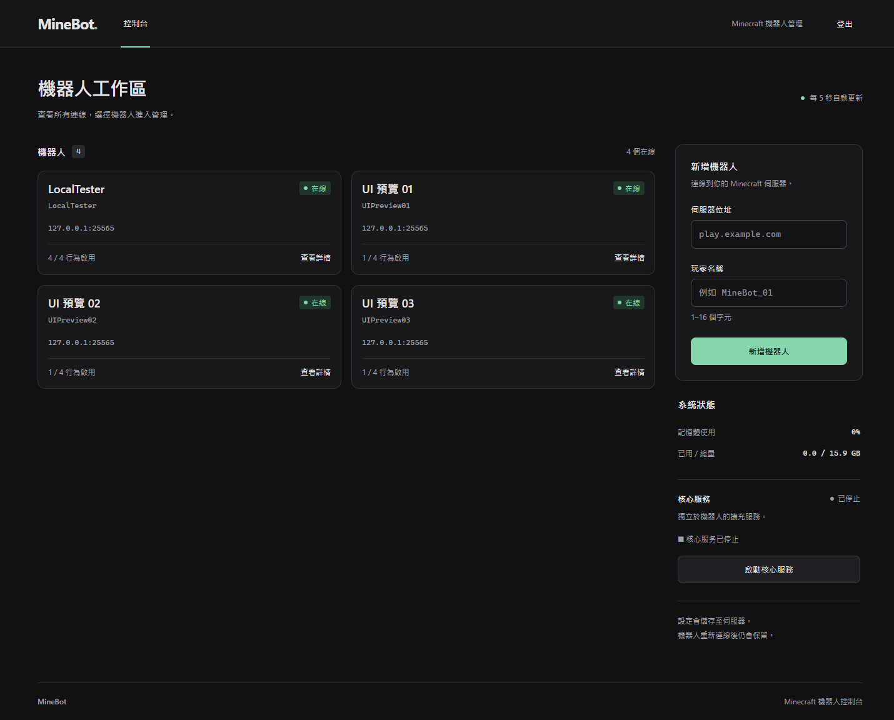
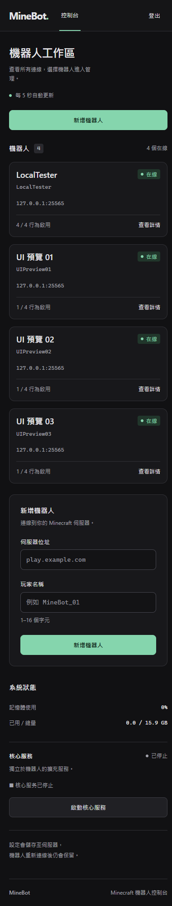

# 控制台使用與驗證

控制台使用 Vue 3 CDN，Express 提供 `public/` 下的 HTML、CSS 與 JavaScript。沒有前端建置步驟，部署時需一併更新 `index.html`、`app-core.js`、`preferences.js`、`console.js`、`console.css` 五個檔案。

## 畫面與導覽

總覽 `#/` 以小卡片顯示每個機器人的名稱、狀態、位址與行為摘要。點擊卡片進入 `#/bots/:id`，只呈現該機器人的日誌與完整操作。支援瀏覽器上一頁、下一頁、重新整理與失效連結提示；同次登入內切頁及輪詢會保留未儲存的表單草稿。

桌機總覽是兩欄卡片與系統側欄；640px 以下卡片改為單欄。961px 以上側欄會隨捲動停留在視窗內，短視窗可獨立捲動；960px 以下恢復正常頁面流。

登入頁與工作區頁頂皆有「語言」「外觀」選單，可獨立切換繁體／簡體中文與暗色／亮色，預設繁中暗色。選擇以 `mb_locale`、`mb_theme` 保存於目前瀏覽器，重新整理與登出後仍保留，不會覆寫登入 token。偏好模組遇到無效值或讀寫失敗時會使用預設值或保留當次選擇；這不代表整個登入流程支援完全封鎖 localStorage。

語言切換涵蓋介面、驗證提示、通知與確認文字；機器人名稱、備註、檔名、原始日誌及未列入詞庫的後端訊息保留原文。切換不重建表單、不送出機器人操作，未儲存草稿仍在。

| 桌機總覽 | 手機總覽 |
|---|---|
|  |  |

[單機詳情](../agent/bot-detail-desktop.png) · [18 個本機測試實例的捲動側欄](../agent/sidebar-follow-desktop.png)

簡中亮色：[桌機總覽](../agent/preferences-light-desktop.png) · [手機總覽](../agent/preferences-light-mobile.png)

截圖使用本機測試實例，不代表跨伺服器相容性或容量基準。

## 自動化測試

安裝專案依賴後執行：

```sh
npm test
node --check public/app-core.js
node --check public/preferences.js
node --check public/console.js
```

`npm test` 執行 26 個 Node 測試，涵蓋 HTML 轉義、日誌顏色白名單、輸入驗證、視圖模型、草稿保存、登出清理、過期回應、核心狀態補查、單機網址導覽，以及偏好預設／保存／降級、首次載入與翻譯參數。

瀏覽器驗收工具是供 Playwright MCP `browser_run_code_unsafe` 載入的 `async (page) => ...` 函式，**不能以 `node tools/…` 取代瀏覽器驗證**。操作方式：

1. 啟動服務，確認 `http://127.0.0.1:4681/` 可開啟。工具目前使用這個固定位址。
2. 使用 `browser_tabs` 建立具名 `isolatedContext` 的新分頁，避免改動日常登入狀態。
3. 使用 `browser_run_code_unsafe`，將 `filename` 設為下表工具的絕對路徑。每個工具各使用獨立 context，執行後確認回傳 `pass: true`，完成後關閉測試分頁。
4. accessibility-check 檢查目前畫面，可在 browser-check 產生的測試詳情頁執行。

| 工具 | 驗證範圍 | 本次結果 |
|---|---|---|
| `tools/console-browser-check.cjs` | 語意、日誌 XSS、五種寬度、44px 操作區及至少 12px 文字 | 通過 |
| `tools/console-interaction-check.cjs` | 登入、機器人控制、翼龍設定／電源／檔案、Core、錯誤及過期狀態 | 62 項通過 |
| `tools/console-navigation-check.cjs` | 多機小卡、單機頁、特殊 ID、歷史、草稿、載入／失效與卡片密度 | 38 項通過 |
| `tools/console-sidebar-check.cjs` | 18 個測試實例、捲動跟隨、短視窗鍵盤操作、手機正常流、頁尾避讓 | 36 項通過 |
| `tools/console-accessibility-check.cjs` | 可見文字對比、欄位名稱及操作尺寸 | 已檢查的總覽、詳情及登入頁通過 |
| `tools/console-preferences-check.cjs` | 登入前後切換、保存、重新整理、草稿與原文保留、四種組合及五種寬度 | 54 項通過 |
| `tools/console-theme-check.cjs` | 三種頁面、兩種語言與主題、桌機／手機的對比及操作區；通知、驗證與確認翻譯 | 31 項通過 |

會產生操作的工具攔截全部 `/api/` 請求，使用測試 fixture；`confirm` 和 `window.open` 在瀏覽器邊界使用替身。工具會設定或清除測試 context 的登入資料；browser-check 會保留 fixture 畫面供檢查，關閉該 context 即可清除。測試不需要真實管理員帳密或翼龍 API Key。

## 驗證紀錄與限制

- 單元測試及瀏覽器驗收均已執行；響應式檢查涵蓋 320、390、768、1024、1440px，側欄另驗證 960／961px 邊界及 600px 短視窗。
- 繁簡及亮暗改版新增 85 項瀏覽器斷言通過，並重新通過既有操作 62 項、導覽 38 項、側欄 36 項回歸。三種頁面在四種語言／主題組合下的文字、placeholder、六種日誌色與操作尺寸均已檢查。
- 偏好 TDD：五項單元測試先因缺少預設、保存、套用與翻譯行為失敗；瀏覽器先因登入頁缺少切換選單失敗。實作後全數通過。在真實瀏覽器暫停 Vue CDN 載入時，已保存的簡中亮色仍先套用成功。
- TDD 曾先重現：登出計時器及舊回應問題、輪詢草稿遺失、Core 回應缺少狀態、單機網址導覽、含空白 ID 的可及名稱、卡片尺寸與側欄不跟隨；修正後相應測試通過。
- 檔案 `attributes.is_file` 辨識與預設目錄路徑以後續整合回歸驗證，沒有宣稱先取得 RED。
- `node --check` 僅驗證語法；`npm test` 不包含瀏覽器工具。沒有獨立 lint、TypeScript 或前端 build 設定。
- 從原版升級後需重新登入。後端重啟會重建機器人 ID，舊詳情網址可能失效，可從總覽重新選取。
- 遠端翼龍與 Linux Core 的副作用未連真實服務驗證；本次確認前端的路由、請求及成功／失敗處理。
- Vue 仍由外部 CDN 載入；未測實體手機、完整螢幕閱讀器流程或量測 Lighthouse／Web Vitals。
